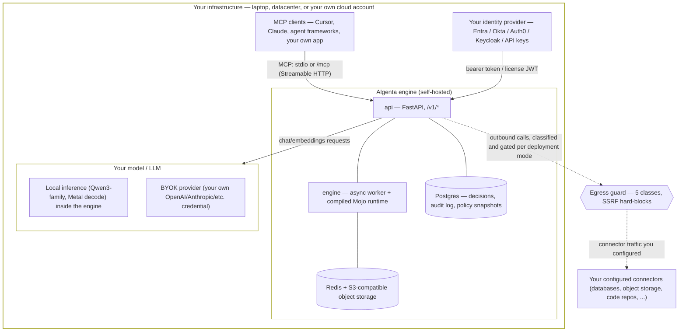

# Architecture and trust boundaries

This is the diagram version of the [shared-responsibility table](overview.md#shared-responsibility-by-deployment-mode): the same facts, drawn as a data-flow so the boundary between "yours" and "Algenta's" is a line on a picture instead of a row in a table.

## Self-hosted, the default and recommended path

Every integration, example, and default in this documentation set points at a deployment you run. There is no step where consuming Algenta requires sending data to Algenta-operated infrastructure.

Everything inside the outer box is infrastructure you control. Nothing crosses out of it except:

- traffic to destinations *you* configured (a connector, a BYOK provider endpoint) — gated by the [egress classification](data-boundaries.md), never blanket-allowed;
- software distribution (pulling the image or package itself) and commercial/license-management metadata, neither of which is your runtime decision data — see the [subprocessor statement](overview.md#subprocessor-statement).

## Where MCP fits

MCP is the primary, mature integration surface (see [Protocol compatibility](protocol-compatibility.md)): an MCP client — a coding assistant, an agent framework, a gateway like LiteLLM's MCP Gateway — talks to your self-hosted `/mcp` endpoint, authenticated the same way any other API caller is (see [Identity and access](identity-and-access.md)). The governed-execution boundary (policy gates, approvals, receipts) is enforced inside the engine on every path that reaches it, MCP included — it is not a property of the transport, so it applies identically whether the caller is an MCP host, a direct HTTP client, or the Responses/Chat Completions surface.

## What this diagram does not claim

- It does not depict a highly-available, active-active engine. The `engine` component is not active-active today, and the [Helm chart](capability-status.md) makes that explicit rather than hiding it: `engine.replicaCount` is hardcoded to `1` and enforced at the schema and template level, not merely defaulted.
- It does not depict Foundry, Toolbox, or any hosted-agent-platform integration as running *inside* this boundary — those are separate, ecosystem-specific deployments that call into a self-hosted engine from outside it, documented per-ecosystem in the framework integrations themselves.
- SaaS and hybrid-provider deployment modes are real but are the exception this documentation set does not default to — see the [shared-responsibility table](overview.md#shared-responsibility-by-deployment-mode) for how the boundary moves in those modes.

## Next steps

- [Data boundaries](data-boundaries.md)
- [Identity and access](identity-and-access.md)
- [Capability status](capability-status.md)
