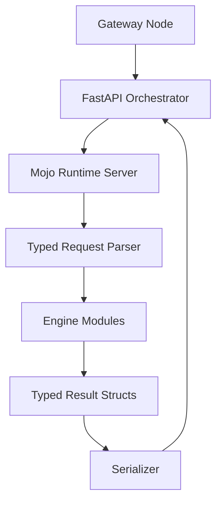

# Mojo-First Decision Runtime — Phased Production Plan

## Goal

Turn the current platform into a **Mojo-first universal decision runtime** that can credibly claim:

- Mojo-native decision compute core
- Mojo-first decision runtime
- No Python bottlenecks in the compute path
- Production-grade latency, concurrency, and observability

## Product Reframe

For Codna, this is not just a simulation engine upgrade. It is a:

**universal decision computation runtime**

That runtime must support, under one coherent internal contract:

- simulation
- decision trees
- time series
- compare / scenario analysis
- scoring / ranking
- optimization
- sensitivity and importance analysis

The goal is not to optimize only Monte Carlo. The goal is to create a typed,
persistent, low-latency decision runtime where **Mojo is the compute core** and
Python / Node remain orchestration and product surfaces.

## Current Claim Status

### Claimable now

- Mojo-native simulation core
- Mojo-first simulation math engine
- Native Mojo execution for Monte Carlo, Sobol, LHS, scenario, sensitivity, bootstrap, MCMC, decision tree, time series, compare, and importance sampling

### Not claimable yet

- Full Mojo-first decision engine without Python bottlenecks

## What the current framing already gets right

The current framing is already strong in two important ways:

1. It keeps the claim boundary around the **engine runtime**, not the whole SaaS stack.
2. It separates technical truth from marketing language, which is required if Codna
   wants to make a serious enterprise-grade Mojo-first claim.

## What must remain outside Mojo

These do **not** block a Mojo-first compute claim and should stay where they are strongest:

- [`apps/gateway/src/index.ts`](apps/gateway/src/index.ts) — gateway, proxying, edge auth, rate limiting
- [`apps/api_server/main.py`](apps/api_server/main.py) — HTTP app lifecycle and service composition
- [`apps/api_server/db/session.py`](apps/api_server/db/session.py) — database connectivity
- [`apps/api_server/services/auth_service.py`](apps/api_server/services/auth_service.py) — auth, API key lifecycle
- [`apps/api_server/services/quota_service.py`](apps/api_server/services/quota_service.py) — billing/quota orchestration
- [`apps/portal`](apps/portal) — portal UX

The claim should be about the **decision runtime**, not the entire SaaS stack.

## What still blocks the claim

### 1. No real persistent Mojo runtime

- [`apps/api_server/compute/mojo_pool.py`](apps/api_server/compute/mojo_pool.py) expects a `--server` Mojo binary
- current binary still does not expose stable server mode
- subprocess fallback remains active in practice

### 2. Python still owns the request boundary

- [`mojo/engine/main.mojo`](mojo/engine/main.mojo) still uses Python `json.loads()`
- request is shaped in Python before Mojo consumes it

### 3. Typed Mojo request/result model is incomplete

- [`mojo/engine/main.mojo`](mojo/engine/main.mojo) still acts as a mixed parser/dispatcher monolith
- some engines still rely on config extraction from Python objects or dispatcher-owned arrays instead of dedicated typed request structs

### 4. Python still owns some post-compute transforms

- [`apps/api_server/services/simulation_service.py`](apps/api_server/services/simulation_service.py)
- [`apps/api_server/services/decision_integrity.py`](apps/api_server/services/decision_integrity.py)
- [`apps/api_server/services/chart_service.py`](apps/api_server/services/chart_service.py)

These are not the worst latency offenders, but they weaken a strong Mojo-first runtime claim.

## Strategic Message for Codna

The right product statement is:

> Codna Decision Engine is a typed, persistent, low-latency decision runtime,
> with Mojo as the compute core and Python / Node as orchestration and product surfaces.

This is stronger than positioning the platform as simply “faster Monte Carlo.”

## Design Principles

Based on the latest Mojo documentation imported into [`docs/mojo`](docs/mojo):

- [`docs/mojo/Calling Python from Mojo.rtfd/TXT.rtf`](docs/mojo/Calling%20Python%20from%20Mojo.rtfd/TXT.rtf)
- [`docs/mojo/Python interoperability.rtfd/TXT.rtf`](docs/mojo/Python%20interoperability.rtfd/TXT.rtf)
- [`docs/mojo/Mojo's libc support.rtfd/TXT.rtf`](docs/mojo/Mojo's%20libc%20support.rtfd/TXT.rtf)
- [`docs/mojo/Unsafe pointers.rtfd/TXT.rtf`](docs/mojo/Unsafe%20pointers.rtfd/TXT.rtf)
- [`docs/mojo/Introduction to layouts.rtfd/TXT.rtf`](docs/mojo/Introduction%20to%20layouts.rtfd/TXT.rtf)
- [`docs/mojo/Compile-time evaluation.rtfd/TXT.rtf`](docs/mojo/Compile-time%20evaluation.rtfd/TXT.rtf)
- [`docs/mojo/Get started with GPU programming.rtfd/TXT.rtf`](docs/mojo/Get%20started%20with%20GPU%20programming.rtfd/TXT.rtf)

The implementation strategy should follow these rules:

- Parse once
- Convert to typed Mojo structs early
- Keep PythonObject boundaries at the edge only
- Use struct-of-arrays data layout in hot paths
- Prefer typed result structs before JSON serialization
- Use binary framing between orchestrator and engine as soon as practical
- Benchmark every phase before claiming progress

## Target Architecture

## Claim Ladder

## Phase 0 — Claim Hygiene and Measurement

### Objective

Stop over-claiming before the runtime is ready and create a benchmark baseline.

### Tasks

- [ ] Define approved claim language for docs, site, SDKs, and sales copy
- [ ] Add benchmark fixture payload set by engine type and variable count
- [ ] Record p50, p95, p99 latency for 10k, 50k, 100k runs
- [ ] Record concurrency benchmarks at 1, 10, 100, and 500 parallel requests
- [ ] Add logs that explicitly state whether runtime used pool, subprocess, or fallback
- [ ] Add CI benchmark guard for regressions

### Exit Criteria

- Benchmark matrix exists and is reproducible
- Published claim language matches reality

## Phase 1 — Persistent Mojo Decision Runtime Server

### Objective

Make Mojo a long-lived decision runtime, not a subprocess binary.

### Files

- [`mojo/engine/main.mojo`](mojo/engine/main.mojo)
- [`apps/api_server/compute/mojo_pool.py`](apps/api_server/compute/mojo_pool.py)
- [`apps/api_server/compute/mojo_adapter.py`](apps/api_server/compute/mojo_adapter.py)

### Tasks

- [ ] Implement real `--server` mode in Mojo
- [ ] Add socket accept loop in Mojo runtime
- [ ] Add length-prefixed request/response framing in Mojo
- [ ] Add ready handshake and health ping in Mojo server mode
- [ ] Add structured worker shutdown path in Mojo
- [ ] Make pool startup fail fast if binary lacks server mode in production config
- [ ] Keep subprocess fallback only for local dev/test mode
- [ ] Add explicit config flag for fallback allowed vs forbidden

### Exit Criteria

- Pool is the default production path
- No subprocess fallback used in production runs
- Claim can move from “Mojo-native core” to “persistent decision runtime”

## Phase 2 — Canonical Decision Schema

### Objective

Define one stable internal contract for all decision engines before deep typed
Mojo implementation spreads across the codebase.

### Why this phase must exist

Without a canonical decision schema, Codna risks becoming a collection of
accelerated analytical modules rather than a unified decision platform. The schema
is the operating system of the decision engine.

### Contract domains

- objectives
- constraints
- uncertainties
- scenarios
- policies
- scoring
- outputs

### Files

- new [`plans/CANONICAL_DECISION_SCHEMA.md`](plans/CANONICAL_DECISION_SCHEMA.md)
- [`apps/api_server/schemas/simulate.py`](apps/api_server/schemas/simulate.py)
- [`apps/api_server/schemas/response.py`](apps/api_server/schemas/response.py)
- [`mojo/engine/types.mojo`](mojo/engine/types.mojo)

### Tasks

- [ ] Define canonical internal decision contract
- [ ] Map every current engine type to that contract
- [ ] Normalize objective, scenario, and scoring semantics across engines
- [ ] Define which fields are mandatory vs engine-specific
- [ ] Define forward-compatibility and versioning rules for the contract

### Exit Criteria

- One stable contract exists for all engines
- No engine evolves its own private request dialect

## Phase 3 — Typed Mojo Request Model

### Objective

Parse request once and hand typed structs to engines.

### Files

- [`mojo/engine/types.mojo`](mojo/engine/types.mojo)
- [`mojo/engine/main.mojo`](mojo/engine/main.mojo)
- [`mojo/engine/compare.mojo`](mojo/engine/compare.mojo)
- [`mojo/engine/importance_sampling.mojo`](mojo/engine/importance_sampling.mojo)
- [`mojo/engine/time_series.mojo`](mojo/engine/time_series.mojo)
- [`mojo/engine/decision_tree.mojo`](mojo/engine/decision_tree.mojo)

### Tasks

- [ ] Create typed request structs for core engine inputs
- [ ] Create typed structs for correlations, scoring, and objective metadata
- [ ] Split dispatcher parsing from engine execution in [`mojo/engine/main.mojo`](mojo/engine/main.mojo)
- [ ] Remove repeated per-engine config parsing where still present
- [ ] Pass typed arrays/structs only to all engine modules
- [ ] Normalize all engine modules to a shared request contract

### Exit Criteria

- No engine hot path reads PythonObject directly
- `main.mojo` is dispatcher + request normalization only

## Phase 4 — Boundary Optimization and Mojo-Native Request Parsing

### Objective

Remove unnecessary overhead at the request boundary. For Codna, the priority is:

- persistent runtime
- typed boundary
- minimal copying
- deterministic request normalization

Mojo-native JSON parsing is valuable, but should be treated as optional until
benchmarks prove it matters more than the preceding items.

### Files

- [`mojo/engine/main.mojo`](mojo/engine/main.mojo)
- new [`mojo/engine/json/`](mojo/engine/json/)

### Tasks

- [ ] Build schema-specific tokenizer for current request shape
- [ ] Parse numbers, booleans, nulls, arrays, and strings directly in Mojo
- [ ] Materialize typed request structs without Python mediation
- [ ] Keep parser narrow to engine payload schema first, not generic JSON DOM
- [ ] Add malformed payload tests

### Exit Criteria

- Boundary copying is minimized
- Typed request normalization is deterministic
- If implemented, Mojo-native JSON parsing replaces Python at the engine boundary
- If not implemented, benchmark evidence shows it is not a meaningful bottleneck

## Phase 5 — Typed Result Model and Binary Boundary

### Objective

Stop building JSON strings manually as the primary internal output type.

### Files

- [`mojo/engine/output.mojo`](mojo/engine/output.mojo)
- [`mojo/engine/types.mojo`](mojo/engine/types.mojo)
- [`apps/api_server/compute/mojo_adapter.py`](apps/api_server/compute/mojo_adapter.py)

### Tasks

- [ ] Create typed `DecisionEnvelopeMojo` result struct
- [ ] Create typed summary, percentiles, risk, and engine-specific result structs
- [ ] Serialize to JSON only at the very edge
- [ ] Evaluate binary protocol between Python and Mojo server
- [ ] Add protocol versioning and compatibility checks

### Exit Criteria

- Internal engine result is typed Mojo data, not string concatenation

## Phase 6 — Mojo-Native Post-Compute Aggregates

### Objective

Push post-compute analytics to Mojo where they are performance-sensitive.

### Files

- [`mojo/engine/stats.mojo`](mojo/engine/stats.mojo)
- [`mojo/engine/output.mojo`](mojo/engine/output.mojo)
- [`apps/api_server/services/chart_service.py`](apps/api_server/services/chart_service.py)
- [`apps/api_server/services/decision_integrity.py`](apps/api_server/services/decision_integrity.py)

### Tasks

- [ ] Generate histogram bins in Mojo
- [ ] Generate CDF points in Mojo
- [ ] Generate tornado aggregates in Mojo
- [ ] Generate fan chart percentile tables in Mojo
- [ ] Generate compare scatter aggregates in Mojo
- [ ] Move result hash creation to Mojo
- [ ] Keep Vega-Lite spec assembly outside the core if needed, but feed it Mojo-generated aggregates

### Exit Criteria

- Python post-processing no longer computes analytics, only formats or persists

## Phase 7 — Engine Module Hardening

### Objective

Turn the current large runtime into composable, testable engine modules.

### Files

- [`mojo/engine/main.mojo`](mojo/engine/main.mojo)
- [`mojo/engine/distributions.mojo`](mojo/engine/distributions.mojo)
- [`mojo/engine/expr.mojo`](mojo/engine/expr.mojo)
- [`mojo/engine/correlation.mojo`](mojo/engine/correlation.mojo)

### Tasks

- [ ] Reduce [`mojo/engine/main.mojo`](mojo/engine/main.mojo) to dispatch-only
- [ ] Split engines into dedicated modules under `mojo/engine/engines/`
- [ ] Add unit tests for parser, evaluator, and per-engine behavior
- [ ] Introduce struct-of-arrays memory layouts where beneficial
- [ ] Add compile-time configuration gates where supported

### Exit Criteria

- Engine modules are testable, composable, and small enough to reason about

## Phase 8 — Performance Moat

### Objective

Make the “Mojo-first” claim obviously true in benchmark data.

### Tasks

- [ ] True SIMD sampling across common distributions
- [ ] Cross-core partitioning as default server runtime behavior
- [ ] Shared-memory worker strategy if stable in current Mojo release
- [ ] GPU feasibility study for high-run-count Monte Carlo
- [ ] Benchmark vs Python, NumPy, and SciPy baselines
- [ ] Publish p50, p95, p99 by workload class

### Exit Criteria

- Clear benchmark dominance in targeted workloads

## Phase 9 — Surface Alignment

### Objective

Make every product surface accurately represent the engine.

### Files

- [`apps/portal`](apps/portal)
- [`packages/python-sdk`](packages/python-sdk)
- [`packages/ts-sdk`](packages/ts-sdk)
- [`apps/docs`](apps/docs)

### Tasks

- [ ] Remove Monte Carlo-first assumptions from portal copy
- [ ] Expose all supported engine types consistently in portal UI
- [ ] Align SDK types with engine-specific fields
- [ ] Align docs claim language with current runtime reality
- [ ] Add runtime capability matrix to docs

### Exit Criteria

- UI, SDKs, and docs all reflect the actual engine contract

## Technical Debt to Retire

- [ ] Remove legacy unused Python engine paths if Mojo parity is complete
- [ ] Remove fake or degraded fallback code paths from production mode
- [ ] Remove request/response field assumptions still hardcoded around Monte Carlo

## Benchmark Gate Before Strong Claim

Required before claiming “full Mojo-first decision engine without Python bottlenecks”:

- [ ] No Python parsing in compute boundary
- [ ] No subprocess fallback in production mode
- [ ] No PythonObject access in any engine hot loop
- [ ] Persistent Mojo runtime active by default
- [ ] p50, p95, p99 benchmark matrix published
- [ ] 100+ concurrent request benchmark passes without runtime degradation

## Recommended Claim Progression

### Now

- Mojo-native simulation core
- Mojo-first decision math engine

### After Phase 1

- Persistent Mojo decision runtime

### After Phase 3

- Mojo-first decision runtime with Python orchestration

### After Phase 5 and benchmark gate

- Full Mojo-first decision runtime without Python compute bottlenecks

## Immediate Implementation Order

- [ ] Phase 1 — persistent Mojo runtime server
- [ ] Phase 2 — canonical decision schema
- [ ] Phase 3 — typed request structs in Mojo
- [ ] Phase 5 — typed result envelope
- [ ] Phase 6 — performance-sensitive post-compute aggregates in Mojo
- [ ] Phase 4 — only then decide whether full Mojo-native parsing is worth the complexity

## Review Notes

This plan assumes:

- Python remains orchestration and platform glue
- Node remains gateway and edge I/O
- Mojo becomes the full compute runtime and typed execution boundary

That is the right architecture for a credible “Mojo-first” claim.
