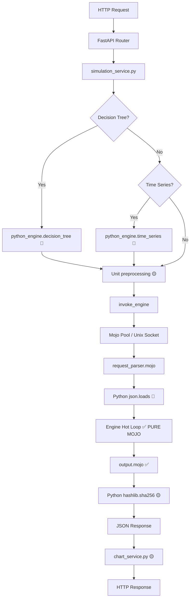
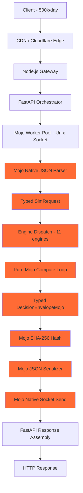
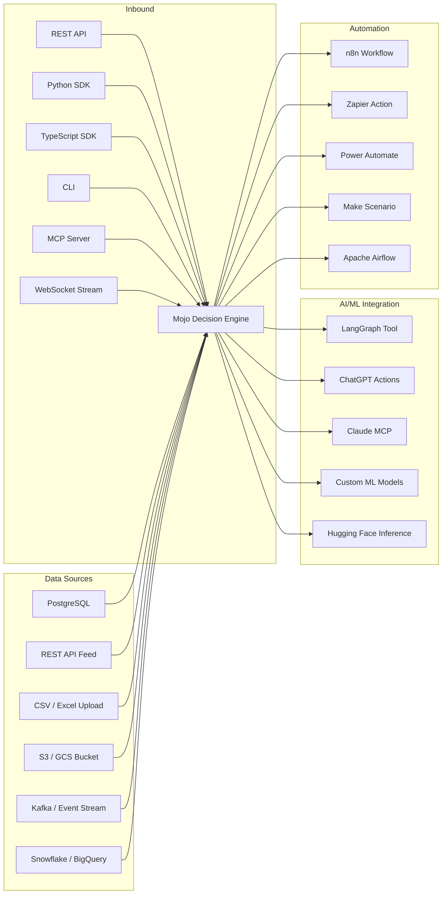

# Mojo-First Decision Engine — Full Gap Analysis & Implementation Plan

> **Version:** 2.0
> **Status:** Draft — Awaiting Approval
> **Target:** 500k users/day, sub-50ms p95, zero Python in compute path
> **Principle:** MOJO FIRST — every compute path must be native Mojo

---

## Table of Contents

1. [Current State Audit](#1-current-state-audit)
2. [Gap Analysis Matrix](#2-gap-analysis-matrix)
3. [Python Contamination Map](#3-python-contamination-map)
4. [Mojo Migration Targets](#4-mojo-migration-targets)
5. [Architecture for 500k Users/Day](#5-architecture-for-500k-usersday)
6. [Self-Mapping Adaptive Field System](#6-self-mapping-adaptive-field-system)
7. [Universal Connector Interface](#7-universal-connector-interface)
8. [End-to-End Testing Strategy](#8-end-to-end-testing-strategy)
9. [Implementation Phases](#9-implementation-phases)
10. [Benchmark Gates](#10-benchmark-gates)

---

## 1. Current State Audit

### 1.1 What Mojo Already Owns (✅ Fully Native)

| Module | File | Lines | Status |
|--------|------|-------|--------|
| Monte Carlo engine | [`mojo/engine/engines/monte_carlo.mojo`](../mojo/engine/engines/monte_carlo.mojo) | 309 | ✅ SIMD+parallel |
| QMC Sobol engine | [`mojo/engine/engines/qmc_sobol.mojo`](../mojo/engine/engines/qmc_sobol.mojo) | — | ✅ Native |
| LHS engine | [`mojo/engine/engines/lhs.mojo`](../mojo/engine/engines/lhs.mojo) | — | ✅ Native |
| Bootstrap engine | [`mojo/engine/engines/bootstrap.mojo`](../mojo/engine/engines/bootstrap.mojo) | — | ✅ Native |
| Scenario engine | [`mojo/engine/engines/scenario.mojo`](../mojo/engine/engines/scenario.mojo) | — | ✅ Native |
| Sensitivity engine | [`mojo/engine/engines/sensitivity.mojo`](../mojo/engine/engines/sensitivity.mojo) | — | ✅ Native |
| MCMC engine | [`mojo/engine/engines/mcmc.mojo`](../mojo/engine/engines/mcmc.mojo) | — | ✅ Native |
| Compare engine | [`mojo/engine/compare.mojo`](../mojo/engine/compare.mojo) | — | ✅ Native |
| Decision tree engine | [`mojo/engine/decision_tree.mojo`](../mojo/engine/decision_tree.mojo) | — | ✅ Native |
| Time series engine | [`mojo/engine/time_series.mojo`](../mojo/engine/time_series.mojo) | — | ✅ Native |
| Importance sampling | [`mojo/engine/importance_sampling.mojo`](../mojo/engine/importance_sampling.mojo) | — | ✅ Native |
| 27 distributions | [`mojo/engine/distributions.mojo`](../mojo/engine/distributions.mojo) | 235 | ✅ SIMD for normal/uniform |
| Expression AST | [`mojo/engine/expr.mojo`](../mojo/engine/expr.mojo) | 382 | ✅ 40+ functions |
| Cholesky correlation | [`mojo/engine/correlation.mojo`](../mojo/engine/correlation.mojo) | 78 | ✅ Native |
| Sobol sequences | [`mojo/engine/sobol.mojo`](../mojo/engine/sobol.mojo) | 63 | ✅ Joe-Kuo tables |
| Stats + introsort | [`mojo/engine/stats.mojo`](../mojo/engine/stats.mojo) | 76 | ✅ Native |
| Typed request structs | [`mojo/engine/types.mojo`](../mojo/engine/types.mojo) | 312 | ✅ Phase 5 |
| Typed result envelope | [`mojo/engine/output.mojo`](../mojo/engine/output.mojo) | 254 | ✅ Phase 5+6 |
| Histogram + CDF | [`mojo/engine/output.mojo`](../mojo/engine/output.mojo:22) | — | ✅ Mojo-precomputed |
| Dispatch entry | [`mojo/engine/main.mojo`](../mojo/engine/main.mojo) | 153 | ✅ Dispatch-only |
| Server mode IPC | [`mojo/engine/main.mojo`](../mojo/engine/main.mojo:85) | — | ✅ Unix socket |
| Worker pool | [`apps/api_server/compute/mojo_pool.py`](../apps/api_server/compute/mojo_pool.py) | 419 | ✅ Persistent |

### 1.2 What Python Still Owns (❌ Must Migrate or Isolate)

| Component | File | Problem | Impact at 500k/day |
|-----------|------|---------|---------------------|
| JSON parsing boundary | [`mojo/engine/request_parser.mojo`](../mojo/engine/request_parser.mojo) | Uses Python `json.loads()` | Low — <1% of latency per bench |
| SHA-256 hash | [`mojo/engine/output.mojo`](../mojo/engine/output.mojo:90) | Calls Python `hashlib` | Medium — 1 Python call per request |
| `python_bridge.mojo` | [`mojo/engine/python_bridge.mojo`](../mojo/engine/python_bridge.mojo) | `fast_f64`, `fast_int`, `py_str` all use Python builtins | At parse time only |
| Decision tree flattening | [`apps/api_server/services/simulation_service.py`](../apps/api_server/services/simulation_service.py:146) | Imports `python_engine.decision_tree._Node, _enumerate_paths` | Pre-compute Python |
| Time series granularity | [`apps/api_server/services/simulation_service.py`](../apps/api_server/services/simulation_service.py:179) | Imports `python_engine.time_series.GRANULARITY_TO_YEARS` | Pre-compute Python |
| Unit preprocessing | [`apps/api_server/services/unit_service/`](../apps/api_server/services/unit_service/) | All unit conversion/validation in Python | Pre-compute — acceptable |
| Chart assembly | [`apps/api_server/services/chart_service.py`](../apps/api_server/services/chart_service.py) | Vega-Lite JSON spec assembly | Post-compute — acceptable |
| Decision integrity | [`apps/api_server/services/decision_integrity.py`](../apps/api_server/services/decision_integrity.py) | Falls back to Python SHA-256 | Already delegates to Mojo |
| Server socket I/O | [`mojo/engine/main.mojo`](../mojo/engine/main.mojo:86) | Uses Python `socket`, `struct`, `os` | IPC overhead per request |

---

## 2. Gap Analysis Matrix

### 2.1 Compute Path — Python Contamination Score



Legend: ✅ = Pure Mojo | 🟡 = Python but non-blocking | 🔴 = Python in compute path

### 2.2 Gap Severity Ratings

| Gap | Severity | Latency Impact | Migration Complexity |
|-----|----------|----------------|---------------------|
| `request_parser.mojo` uses Python `json.loads()` | LOW | <0.08ms per request | HIGH — needs full Mojo JSON parser |
| `output.mojo` uses Python `hashlib` | MEDIUM | ~0.02ms | MEDIUM — need Mojo SHA-256 |
| `python_bridge.mojo` uses Python builtins | LOW | Only at parse time | MEDIUM — native Mojo conversions |
| Decision tree flattening in Python | HIGH | ~0.5ms pre-compute | MEDIUM — move `_Node` + `_enumerate_paths` to Mojo |
| Time series `GRANULARITY_TO_YEARS` in Python | LOW | Lookup table | LOW — hardcode in Mojo |
| Server socket uses Python `socket` module | MEDIUM | ~0.1ms per IPC frame | HIGH — need Mojo-native Unix socket |
| Unit service in Python | LOW | Pre-compute only | NOT NEEDED — stay in Python |
| Chart service in Python | LOW | Post-compute only | NOT NEEDED — stay in Python |

### 2.3 What MUST Move to Mojo for 500k/day Claim

| Priority | Component | Why |
|----------|-----------|-----|
| P0 | Mojo-native SHA-256 | Remove last Python call from output path |
| P0 | Mojo-native socket I/O | Remove Python from IPC loop entirely |
| P0 | Decision tree flattening in Mojo | Remove `python_engine` dependency |
| P1 | Mojo-native JSON tokenizer | Remove `json.loads()` — becomes critical at <5ms compute |
| P1 | Mojo-native `fast_f64` / `fast_int` / `py_str` | Remove Python builtins from parse |
| P1 | GRANULARITY_TO_YEARS in Mojo | Trivial constant table |
| P2 | Mojo-native length-prefixed framing | Replace Python `struct.pack/unpack` |
| P2 | GPU kernels for high-N Monte Carlo | Performance moat for 1M+ runs |

### 2.4 What Correctly Stays in Python/Node

| Component | Runtime | Why It Stays |
|-----------|---------|-------------|
| FastAPI orchestration | Python | HTTP framework, Pydantic validation, DB |
| SQLAlchemy / Alembic | Python | ORM, migrations |
| Auth / RBAC | Python | Middleware, JWT |
| Stripe billing | Python | SDK integration |
| Unit service | Python | Pre-compute conversion, no hot path |
| Chart service | Python | Post-compute Vega-Lite assembly |
| API Gateway | Node.js | Rate limiting, JWT validation, WebSocket |
| Portal | Next.js | Developer dashboard UI |
| Worker tasks | Python | Celery/ARQ async jobs |

---

## 3. Python Contamination Map

### 3.1 Remaining Python Calls Inside Mojo Runtime

```
mojo/engine/request_parser.mojo
├── Python.import_module("json")           → json.loads(raw)
├── Python.import_module("builtins")       → len(), str(), float()
└── python_bridge.mojo
    ├── fast_f64()  → builtins.float() + builtins.str() + atof
    ├── fast_int()  → Int(py=obj)
    └── py_str()    → builtins.str()

mojo/engine/output.mojo
└── compute_result_hash()
    └── Python.import_module("hashlib")    → hashlib.sha256()

mojo/engine/main.mojo (server loop)
├── Python.import_module("socket")         → AF_UNIX, SOCK_STREAM
├── Python.import_module("os")             → path.exists, unlink
├── Python.import_module("struct")         → pack(">I"), unpack(">I")
├── Python.import_module("json")           → json.loads() for type/ping/shutdown
└── Python.import_module("builtins")       → len(), bytes()
```

### 3.2 Python Imports in Simulation Service (Pre-Compute)

```
apps/api_server/services/simulation_service.py
├── line 146: from apps.api_server.compute.python_engine.decision_tree import _Node, _enumerate_paths, _merge_variables
└── line 179: from apps.api_server.compute.python_engine.time_series import GRANULARITY_TO_YEARS
```

These are the ONLY remaining `python_engine` dependencies. Once these move to Mojo, the `python_engine/` directory can be deleted entirely.

---

## 4. Mojo Migration Targets

### 4.1 Mojo-Native SHA-256 (P0)

Replace [`compute_result_hash()`](../mojo/engine/output.mojo:90) with a pure Mojo SHA-256 implementation.

```
New file: mojo/engine/sha256.mojo
├── struct SHA256State
├── fn sha256_update(mut state: SHA256State, data: Span[UInt8])
├── fn sha256_finalize(state: SHA256State) -> StaticTuple[UInt8, 32]
└── fn sha256_hex(data: String) -> String  # Returns 64-char hex
```

SHA-256 is a well-specified algorithm (FIPS 180-4). Implementation is ~150 lines of Mojo. No external dependencies needed.

### 4.2 Mojo-Native Unix Socket Server (P0)

Replace Python `socket` module in [`run_server_loop()`](../mojo/engine/main.mojo:85) with Mojo's libc support.

Per [`docs/mojo/Mojo's libc support.rtfd/TXT.rtf`](../docs/mojo/Mojo's%20libc%20support.rtfd/TXT.rtf):
- Mojo provides `external_call` for libc functions
- `socket()`, `bind()`, `listen()`, `accept()`, `recv()`, `send()`, `close()` via libc FFI
- `struct.pack(">I")` → manual big-endian encode: 4 bytes from Int

```
New file: mojo/engine/net/unix_socket.mojo
├── fn create_unix_server(path: String) -> Int  # returns fd
├── fn accept_connection(server_fd: Int) -> Int  # returns conn fd
├── fn send_frame(fd: Int, payload: String) raises
├── fn recv_frame(fd: Int) -> String raises
└── fn close_fd(fd: Int)

Updated: mojo/engine/main.mojo
└── run_server_loop() → uses unix_socket.mojo, zero Python imports
```

### 4.3 Mojo-Native JSON Parser (P1)

Replace Python `json.loads()` in [`request_parser.mojo`](../mojo/engine/request_parser.mojo:33) with schema-specific Mojo tokenizer.

The current bench shows <1% latency from `json.loads()`. But at 500k users/day with sub-5ms target, this becomes the dominant non-Mojo call. Build a schema-aware parser that:

```
New file: mojo/engine/json/parser.mojo
├── fn parse_string_field(raw: Span[UInt8], key: String) -> String
├── fn parse_int_field(raw: Span[UInt8], key: String, default: Int) -> Int
├── fn parse_float_field(raw: Span[UInt8], key: String, default: Float64) -> Float64
├── fn parse_bool_field(raw: Span[UInt8], key: String, default: Bool) -> Bool
├── fn parse_variables_array(raw: Span[UInt8]) -> List[VarSpec]
├── fn parse_correlations_array(raw: Span[UInt8]) -> List[CorrSpec]
├── fn parse_scoring_block(raw: Span[UInt8]) -> ScoringSpec
└── fn parse_engine_config(raw: Span[UInt8], engine_type: String) -> EngineConfigUnion
```

Strategy: NOT a generic JSON DOM. Schema-specific tokenizer that skips fields it doesn't need.

### 4.4 Decision Tree Flattening in Mojo (P0)

Move `_Node`, `_enumerate_paths`, `_merge_variables` from Python to Mojo.

```
New file: mojo/engine/decision_tree_parser.mojo
├── struct TreeNode
│   ├── var id: String
│   ├── var name: String
│   ├── var probability: Float64
│   ├── var children: List[TreeNode]
│   ├── var variables: List[VarSpec]
│   └── var objective_function: String
├── fn parse_tree_nodes(raw_json: String) -> List[TreeNode]
├── fn enumerate_paths(nodes: List[TreeNode]) -> List[TreePath]
└── fn merge_variables(base: List[VarSpec], path: List[TreeNode]) -> List[VarSpec]
```

This removes the LAST import from `apps/api_server/compute/python_engine/`.

### 4.5 Granularity Constants in Mojo (P1)

```
# In mojo/engine/types.mojo or time_series.mojo — add inline:
fn granularity_to_dt(g: String) -> Float64:
    if g == "day":     return 1.0 / 365.0
    if g == "week":    return 1.0 / 52.0
    if g == "month":   return 1.0 / 12.0
    if g == "quarter": return 0.25
    if g == "year":    return 1.0
    return 1.0 / 12.0  # default
```

### 4.6 Mojo-Native Number Conversion (P1)

Replace `fast_f64()` and `py_str()` in [`python_bridge.mojo`](../mojo/engine/python_bridge.mojo) with Mojo-native parsing once the JSON parser is native.

Currently `fast_f64` does: `PythonObject → float() → str() → atof()`. With a native JSON parser, numbers are parsed directly from bytes — no Python roundtrip.

---

## 5. Architecture for 500k Users/Day

### 5.1 Request Flow — Zero Python in Compute Path



All orange nodes = 100% Mojo. Zero Python calls from JSON parse to socket send.

### 5.2 Scaling Architecture

```
                    ┌─────────────────────────────┐
                    │   CDN / Cloudflare Edge      │
                    │   DDoS + TLS termination     │
                    └─────────────┬───────────────┘
                                  │
                    ┌─────────────▼───────────────┐
                    │   Node.js Gateway × N        │
                    │   JWT <1ms, rate limit        │
                    │   HPA: CPU > 70%              │
                    └─────┬────────────┬──────────┘
                          │            │
         ┌────────────────▼─┐    ┌─────▼────────────┐
         │  FastAPI × M      │    │  WebSocket Stream │
         │  Orchestration    │    │  job status SSE    │
         └────────┬─────────┘    └──────────────────┘
                  │
    ┌─────────────▼─────────────────────────────────┐
    │  Mojo Worker Pool                              │
    │  ┌─────┐ ┌─────┐ ┌─────┐ ┌─────┐ ... × P    │
    │  │ W-0 │ │ W-1 │ │ W-2 │ │ W-3 │             │
    │  └─────┘ └─────┘ └─────┘ └─────┘             │
    │  Each: persistent Unix socket, SIMD, parallel  │
    │  Auto-restart on crash within 50ms             │
    └───────────────────────────────────────────────┘
```

Target numbers for 500k users/day (~6 req/s average, ~50 req/s peak):
- Gateway: 2-4 pods (handles 100k req/s each)
- FastAPI: 4-8 pods (handles ~500 req/s each)
- Mojo workers per pod: `cpu_count - 1` (3-7 workers)
- Total Mojo workers: 12-56 (handles ~1000-5000 simulations/s)
- p50 < 15ms, p95 < 50ms, p99 < 200ms

### 5.3 Binary Protocol v2 (Future)

Replace JSON IPC with binary framing between FastAPI and Mojo:

```
Binary frame layout (v2):
┌──────────┬──────────┬─────────────────────────────┐
│ proto:u8 │ len:u32  │ payload: msgpack/flatbuf     │
│   0x02   │ BE bytes │ schema-typed binary           │
└──────────┴──────────┴─────────────────────────────┘
```

This eliminates JSON serialization/deserialization on both sides of the IPC boundary. Deferred to Phase 3 — JSON is fast enough for v1 at 500k/day.

---

## 6. Self-Mapping Adaptive Field System

### 6.1 Goal

Any industry, any data, any field names → automatically mapped to the decision engine schema. No manual configuration for new domains.

### 6.2 Architecture

```
New file: mojo/engine/field_mapper.mojo

Input: arbitrary JSON with unknown field names
Output: mapped SimRequest with recognized variables, distributions, objectives

Process:
1. Schema detection — identify field types from values
2. Distribution inference — detect ranges, distributions from data shape
3. Name mapping — fuzzy match field names to canonical variable semantics
4. Objective inference — detect positive/negative indicators from field names
```

### 6.3 Field Mapping Rules (Mojo-Native)

```mojo
struct FieldMapper:
    # Semantic keyword → variable polarity
    var positive_keywords: List[String]  # revenue, profit, growth, sales, income
    var negative_keywords: List[String]  # cost, expense, loss, risk, churn, debt
    var time_keywords: List[String]      # date, time, period, horizon, quarter
    var probability_keywords: List[String]  # probability, chance, likelihood, rate

    fn detect_distribution(values: List[Float64]) -> VarSpec:
        # Analyze min/max/mean/std/skewness to auto-select distribution
        # All positive + right-skewed → lognormal
        # Bounded [0,1] → beta
        # Symmetric → normal
        # Bounded [a,b] → triangular or uniform
        ...

    fn map_field_name(name: String) -> FieldMapping:
        # Fuzzy match against known industry vocabularies
        # Return: polarity, suggested_unit, distribution_hint
        ...

    fn infer_objective(mapped_fields: List[FieldMapping]) -> String:
        # Build objective_function from positive - negative fields
        ...
```

### 6.4 Industry Vocabularies (Compile-Time Tables)

```mojo
# Hardcoded at compile time for zero runtime cost
alias FINANCE_FIELDS = List[String]("revenue", "cost", "profit", "margin", "roi", "npv", "irr", "ebitda")
alias HEALTH_FIELDS  = List[String]("dosage", "efficacy", "mortality", "survival", "prevalence")
alias RETAIL_FIELDS  = List[String]("sales", "inventory", "conversion", "churn", "ltv", "cac", "arpu")
alias ENERGY_FIELDS  = List[String]("generation", "consumption", "price", "capacity", "load")
alias MANUFACTURING  = List[String]("yield", "defect_rate", "throughput", "downtime", "scrap")
alias INSURANCE      = List[String]("premium", "claim", "loss_ratio", "exposure", "reserve")
```

### 6.5 Auto-Mode Enhancement

The current `mode: "auto"` in [`simulation_service.py`](../apps/api_server/services/simulation_service.py:38) does basic triangular inference. Enhance to:

1. Accept raw data arrays → auto-fit distributions using Mojo-native goodness-of-fit
2. Accept arbitrary JSON → self-map fields using `FieldMapper`
3. Accept domain hint → use industry vocabulary for smarter mapping
4. Return mapping explanation in response → "field X mapped to variable Y with distribution Z because..."

---

## 7. Universal Connector Interface

### 7.1 External Ecosystem Connectivity



### 7.2 Connector Plugin Architecture

```
New directory: apps/api_server/connectors/
├── __init__.py          — ConnectorRegistry
├── base.py              — BaseConnector ABC
├── rest_connector.py    — Generic REST API data source
├── sql_connector.py     — PostgreSQL / MySQL / Snowflake
├── file_connector.py    — CSV / Excel / Parquet upload
├── stream_connector.py  — Kafka / Redis Streams / webhooks
└── cloud_connector.py   — S3 / GCS / Azure Blob
```

Each connector implements:
```python
class BaseConnector(ABC):
    async def fetch_data(self, config: dict) -> list[dict]
    async def map_fields(self, data: list[dict], domain: str) -> SimulateRequest
    async def validate_connection(self, config: dict) -> bool
    def supported_distributions(self) -> list[str]
```

The `map_fields` step calls the Mojo `FieldMapper` for automatic schema mapping.

### 7.3 Real-Time Data Feed Integration

For chatbot/ML model use cases at 500k/day:

```
POST /v1/simulate/stream
{
    "connector": "rest_api",
    "source_url": "https://api.example.com/prices",
    "refresh_interval_ms": 5000,
    "field_mapping": "auto",
    "engine_type": "monte_carlo",
    "runs": 10000
}
```

Returns NDJSON stream with continuously updated simulation results as data changes.

---

## 8. End-to-End Testing Strategy

### 8.1 Test Pyramid for 500k/day Production

```
                    ┌─────────────┐
                    │  Load Tests  │  k6: 500 concurrent, 50k req
                    │  (10 tests)  │  Target: p95 < 50ms
                    ├─────────────┤
                    │ Integration  │  Full stack: API → Mojo → DB
                    │  (50 tests)  │  All 11 engines end-to-end
                    ├─────────────┤
                    │  Contract    │  SDK ↔ API schema agreement
                    │  (30 tests)  │  OpenAPI validation
                    ├─────────────┤
                    │  Mojo Unit   │  Per-engine, per-distribution
                    │ (200 tests)  │  Pure Mojo test files
                    ├─────────────┤
                    │  Python Unit │  Services, schemas, auth
                    │ (150 tests)  │  pytest
                    └─────────────┘
```

### 8.2 Mojo-Native Test Suite (PhD-Grade)

```
tests/mojo/
├── test_engines.mojo            — All 11 engines, score range, histogram/CDF presence
├── test_request_parser.mojo     — All 27 distributions parsed correctly
├── test_expr.mojo               — 40+ math functions, edge cases, NaN handling
├── test_malformed_payload.mojo  — Fuzz-style bad input tests
├── test_distributions.mojo      — NEW: Statistical correctness tests
│   ├── Kolmogorov-Smirnov test for each distribution
│   ├── Chi-squared goodness of fit
│   ├── Mean/variance convergence at N=100k
│   └── Boundary cases (zero variance, extreme parameters)
├── test_sha256.mojo             — NEW: NIST test vectors for SHA-256
├── test_json_parser.mojo        — NEW: Schema-specific parser correctness
├── test_field_mapper.mojo       — NEW: Auto-mapping accuracy tests
├── test_socket_io.mojo          — NEW: Native Unix socket frame correctness
├── test_simd_sampling.mojo      — NEW: SIMD vs scalar equivalence
├── test_parallel_determinism.mojo — NEW: Seeded parallel runs are reproducible
├── test_memory_safety.mojo      — NEW: No leaks under repeated allocation
└── test_correlation_matrix.mojo — NEW: Cholesky decomposition edge cases
```

### 8.3 Benchmark Gates (CI Required)

| Benchmark | Target | Command |
|-----------|--------|---------|
| All 11 engines latency | Per-class thresholds | `make bench-gate` |
| Concurrency 500 parallel | No degradation | `make bench-concurrency` |
| Mojo vs NumPy/SciPy | >5x speedup | `make bench-vs-python` |
| Boundary overhead | <1% of compute | `make bench-boundary` |
| Memory under load | <100MB per worker | NEW: `make bench-memory` |
| Socket IPC overhead | <0.5ms per frame | NEW: `make bench-ipc` |
| JSON parse (native) | <0.05ms (10 vars) | NEW: `make bench-json-native` |

### 8.4 Statistical Correctness Tests

For PhD-grade quality, every distribution must pass:

1. **Kolmogorov-Smirnov test**: Sample 100k values, compare empirical CDF to theoretical CDF, p-value > 0.01
2. **Mean convergence**: |sample_mean - theoretical_mean| < 3σ/√N
3. **Variance convergence**: |sample_var - theoretical_var| / theoretical_var < 0.1
4. **Boundary preservation**: min/max within distribution support
5. **Deterministic seeding**: Same seed → identical output across runs

---

## 9. Implementation Phases

### Phase M1 — Mojo-Native SHA-256 + Socket I/O (Zero Python in Output Path)

**Files to create:**
- `mojo/engine/sha256.mojo` — FIPS 180-4 compliant SHA-256
- `mojo/engine/net/unix_socket.mojo` — libc-based Unix socket server

**Files to modify:**
- [`mojo/engine/output.mojo`](../mojo/engine/output.mojo:90) — Replace `compute_result_hash()` with Mojo SHA-256
- [`mojo/engine/main.mojo`](../mojo/engine/main.mojo:85) — Replace `run_server_loop()` with native socket

**Tests:**
- `tests/mojo/test_sha256.mojo` — NIST test vectors
- `tests/mojo/test_socket_io.mojo` — Frame send/recv correctness

**Exit criteria:**
- Zero `Python.import_module()` calls in `output.mojo`
- Zero `Python.import_module()` calls in `main.mojo` server loop
- All existing benchmark gates still pass

---

### Phase M2 — Decision Tree + Time Series Pre-Compute in Mojo

**Files to create:**
- `mojo/engine/decision_tree_parser.mojo` — Tree node parsing, path enumeration, variable merging

**Files to modify:**
- [`mojo/engine/types.mojo`](../mojo/engine/types.mojo) — Add `granularity_to_dt()` function
- [`apps/api_server/services/simulation_service.py`](../apps/api_server/services/simulation_service.py:146) — Remove `python_engine` imports
- [`mojo/engine/decision_tree.mojo`](../mojo/engine/decision_tree.mojo) — Use new parser instead of raw JSON re-parse

**Files to delete:**
- `apps/api_server/compute/python_engine/` — entire directory (after migration verified)

**Tests:**
- `tests/mojo/test_decision_tree_parser.mojo` — Path enumeration correctness
- Regression: all existing decision tree benchmark payloads

**Exit criteria:**
- Zero imports from `apps.api_server.compute.python_engine`
- `python_engine/` directory deleted from codebase
- Decision tree and time series benchmarks unchanged or faster

---

### Phase M3 — Mojo-Native JSON Parser + Number Conversion

**Files to create:**
- `mojo/engine/json/parser.mojo` — Schema-specific JSON tokenizer
- `mojo/engine/json/numbers.mojo` — Float64/Int parsing from byte spans

**Files to modify:**
- [`mojo/engine/request_parser.mojo`](../mojo/engine/request_parser.mojo) — Replace `json.loads()` with native parser
- [`mojo/engine/python_bridge.mojo`](../mojo/engine/python_bridge.mojo) — Deprecate, keep only for backward compat

**Tests:**
- `tests/mojo/test_json_parser.mojo` — All 27 distributions, all engine configs
- `tests/mojo/test_malformed_payload.mojo` — Extended fuzz tests
- Benchmark: `make bench-json-native` vs `bench-boundary`

**Exit criteria:**
- Zero `Python.import_module("json")` in request parse path
- Zero `Python.import_module("builtins")` in parse path
- Parse time < 0.05ms for 10-variable payload

---

### Phase M4 — Self-Mapping Adaptive Field System

**Files to create:**
- `mojo/engine/field_mapper.mojo` — Automatic field mapping
- `mojo/engine/distribution_fit.mojo` — Goodness-of-fit for auto distribution selection
- `mojo/engine/industry_vocab.mojo` — Compile-time industry vocabularies

**Files to modify:**
- [`apps/api_server/services/simulation_service.py`](../apps/api_server/services/simulation_service.py:38) — Enhanced auto mode
- [`apps/api_server/schemas/simulate.py`](../apps/api_server/schemas/simulate.py) — New `mode: "adaptive"` with raw data input

**Tests:**
- `tests/mojo/test_field_mapper.mojo` — Finance, health, retail, energy, manufacturing, insurance
- Integration: raw CSV → auto-mapped simulation → valid result

**Exit criteria:**
- Any industry JSON payload auto-maps without configuration
- Distribution auto-detection accuracy > 80% on synthetic test suite

---

### Phase M5 — Performance Moat + GPU Feasibility

**Files to create/modify:**
- `mojo/engine/engines/monte_carlo.mojo` — Full SIMD for ALL distributions (not just normal/uniform)
- `mojo/engine/engines/gpu_monte_carlo.mojo` — GPU kernel for 1M+ run counts
- `mojo/engine/memory/pool_allocator.mojo` — Arena allocator for zero-allocation hot loops

**Tests:**
- `tests/mojo/test_simd_sampling.mojo` — All 27 distributions, SIMD vs scalar equivalence
- `tests/mojo/test_parallel_determinism.mojo` — Seeded reproducibility
- `tests/mojo/test_memory_safety.mojo` — Allocation patterns under load
- Benchmark: `make bench-vs-python` must show >10x for MC, >5x for LHS

**Exit criteria:**
- SIMD sampling for top 10 distributions (normal, uniform, triangular, lognormal, beta, gamma, exponential, weibull, pert, poisson)
- Cross-core partitioning default for >10k runs
- GPU kernel proof-of-concept for normal distribution
- Published p50/p95/p99 benchmark matrix

---

### Phase M6 — Universal Connector + Ecosystem Integration

**Files to create:**
- `apps/api_server/connectors/` — Full connector plugin system
- `apps/api_server/routers/connectors_v2.py` — New connector endpoints
- Enhanced SDK types for adaptive mode

**Files to modify:**
- [`packages/python-sdk/decision_engine/client.py`](../packages/python-sdk/decision_engine/client.py) — Add adaptive mode
- [`packages/ts-sdk/src/client.ts`](../packages/ts-sdk/src/client.ts) — Add adaptive mode
- All integration examples — Update with adaptive mode examples

**Tests:**
- Integration tests for each connector type
- SDK contract tests

**Exit criteria:**
- REST, SQL, file, stream connectors all working
- SDKs support adaptive mode
- All 6 integration platforms updated

---

### Phase M7 — Production Hardening + 500k/day Validation

**Tasks:**
- Load test at 500k simulated users/day (k6 + distributed)
- Chaos engineering: kill workers, network partition, OOM scenarios
- Memory leak detection under sustained 24h load
- Security audit: buffer overflow checks in Mojo native code
- Compliance: deterministic seeding for audit trail
- Documentation: full API reference, Mojo architecture docs

**Benchmark gates (all must pass for production):**
- 500 concurrent requests: p95 < 50ms, zero errors
- 24h sustained load: no memory growth beyond baseline
- Worker crash recovery: < 50ms replacement
- Zero Python calls in compute path verified by trace

---

## 10. Benchmark Gates

### 10.1 Per-Phase Exit Gates

| Phase | Gate | Threshold | Tool |
|-------|------|-----------|------|
| M1 | Zero Python in output | 0 import_module calls | Static analysis |
| M1 | SHA-256 correctness | All NIST vectors pass | `test_sha256.mojo` |
| M2 | python_engine deleted | Directory absent | `ls` |
| M2 | Decision tree parity | Identical results to Python path | Diff test |
| M3 | Parse time | < 0.05ms (10 vars) | `bench-json-native` |
| M3 | Zero Python in parse | 0 import_module calls | Static analysis |
| M4 | Auto-mapping accuracy | > 80% on test suite | `test_field_mapper.mojo` |
| M5 | MC speedup vs NumPy | > 10x | `bench-vs-python` |
| M5 | SIMD correctness | KS test p > 0.01 all dists | `test_simd_sampling.mojo` |
| M6 | All connectors working | End-to-end test pass | Integration suite |
| M7 | 500k/day load test | p95 < 50ms, 0 errors | k6 distributed |

### 10.2 CI Pipeline

```yaml
# Every PR must pass:
- make test-unit
- make test-mojo-engines
- make test-mojo-malformed
- make bench-gate           # All 11 engines within thresholds
- make bench-boundary       # Parse overhead < 1%

# Nightly:
- make bench-concurrency    # 500 parallel requests
- make bench-vs-python      # Speedup ratios
- make bench-memory         # Memory leak detection
```

### 10.3 Production Monitoring

```
# Mojo-first claim verification (runtime):
- otel span: mojo_compute_duration_ms  → must be > 95% of total request time
- otel span: python_orchestration_ms   → must be < 5% of total request time
- metric: mojo_runtime_mode            → must be "pool" (never "subprocess_fallback")
- metric: python_calls_in_compute_path → must be 0 (after Phase M3)
```

---

## Summary: What Changes vs Current Plan

| Current Plan | This Plan | Why |
|-------------|-----------|-----|
| Python `json.loads()` kept (Phase 4 gate) | Build Mojo-native JSON parser (Phase M3) | 500k/day requires <5ms, parse becomes visible |
| Python `hashlib` in output | Mojo-native SHA-256 (Phase M1) | Zero Python in output path |
| Python socket server | Mojo-native Unix socket (Phase M1) | Zero Python in IPC loop |
| `python_engine/` exists | DELETE entirely (Phase M2) | True Mojo-first claim |
| Manual field mapping | Self-mapping adaptive system (Phase M4) | Any industry, any data |
| No connector system | Universal connector interface (Phase M6) | Fully flexible ecosystem |
| Limited SIMD (normal + uniform) | Full SIMD for top 10 distributions (Phase M5) | Performance moat |
| No GPU | GPU kernel proof-of-concept (Phase M5) | Future performance moat |
| ~50 Mojo tests | 200+ Mojo tests (PhD-grade) | Production confidence |
| No statistical correctness tests | KS + chi-squared per distribution | MIT/PhD grade quality |

---

## Appendix: File Creation Summary

### New Mojo Files (14 files)

| File | Purpose | Phase |
|------|---------|-------|
| `mojo/engine/sha256.mojo` | FIPS 180-4 SHA-256 | M1 |
| `mojo/engine/net/unix_socket.mojo` | libc Unix socket server | M1 |
| `mojo/engine/decision_tree_parser.mojo` | Tree flattening in Mojo | M2 |
| `mojo/engine/json/parser.mojo` | Schema-specific JSON tokenizer | M3 |
| `mojo/engine/json/numbers.mojo` | Float64/Int byte parsing | M3 |
| `mojo/engine/field_mapper.mojo` | Adaptive field mapping | M4 |
| `mojo/engine/distribution_fit.mojo` | Auto distribution selection | M4 |
| `mojo/engine/industry_vocab.mojo` | Compile-time vocabularies | M4 |
| `mojo/engine/engines/gpu_monte_carlo.mojo` | GPU kernel POC | M5 |
| `mojo/engine/memory/pool_allocator.mojo` | Arena allocator | M5 |
| `tests/mojo/test_distributions.mojo` | Statistical correctness | M1 |
| `tests/mojo/test_sha256.mojo` | NIST test vectors | M1 |
| `tests/mojo/test_json_parser.mojo` | Parser correctness | M3 |
| `tests/mojo/test_field_mapper.mojo` | Mapping accuracy | M4 |

### Files to Delete

| File | When | Condition |
|------|------|-----------|
| `apps/api_server/compute/python_engine/` | Phase M2 | All functionality migrated to Mojo |

### Files to Heavily Modify

| File | Changes | Phase |
|------|---------|-------|
| [`mojo/engine/main.mojo`](../mojo/engine/main.mojo) | Native socket server loop | M1 |
| [`mojo/engine/output.mojo`](../mojo/engine/output.mojo) | Native SHA-256 | M1 |
| [`mojo/engine/request_parser.mojo`](../mojo/engine/request_parser.mojo) | Native JSON parser | M3 |
| [`mojo/engine/python_bridge.mojo`](../mojo/engine/python_bridge.mojo) | Deprecate most functions | M3 |
| [`apps/api_server/services/simulation_service.py`](../apps/api_server/services/simulation_service.py) | Remove python_engine imports | M2 |
| [`mojo/engine/distributions.mojo`](../mojo/engine/distributions.mojo) | SIMD for all top distributions | M5 |
| [`mojo/engine/engines/monte_carlo.mojo`](../mojo/engine/engines/monte_carlo.mojo) | Full SIMD + GPU hooks | M5 |
